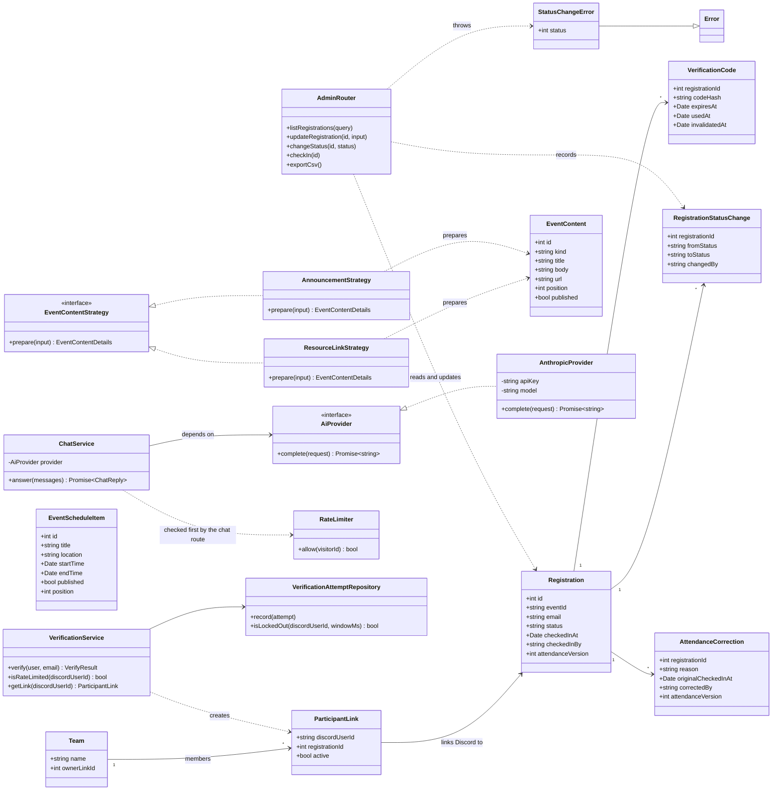

# Sprint 2 Class Diagram

The main classes, interfaces, and database tables added or changed in Sprint 2, grouped by who built them. Tables are shown as classes with their key columns. The chatbot's activity diagram is in [chatbot-activity-diagram.md](../chatbot-activity-diagram.md).

## Design patterns

- **Strategy:** `EventContentStrategy` in `artifacts/api-server/src/lib/eventContent.ts`. `AnnouncementStrategy` and `ResourceLinkStrategy` each validate one kind of event content (FR-13, PR #68).
- **Adapter:** `AiProvider` in `artifacts/api-server/src/lib/chat/aiProvider.ts`. `AnthropicProvider` adapts the Anthropic API to it, and `ChatService` depends only on the interface (FR-20, PR #87).

## Owners

| Area | Owner | Classes |
| --- | --- | --- |
| Registrations and organizer dashboard | Mohammad Altiwainy | Registration, RegistrationStatusChange, AdminRouter, StatusChangeError |
| Discord bot verification, roles, and teams | Tahmid Ambia | VerificationService, ParticipantLink, Team |
| Event content, check-in, and attendance corrections | Arian Azad | EventContentStrategy, AnnouncementStrategy, ResourceLinkStrategy, EventContent, AttendanceCorrection |
| Verification codes and FAQ chatbot | Tajwar Khan | VerificationCode, AiProvider, AnthropicProvider, ChatService, RateLimiter |
| Event schedule, Event Hub, and verification lockout | Sammy Moussa | EventScheduleItem, VerificationAttemptRepository |
